  

  
  
  

## About Me

  

## What I Do

  

## Tech Stack

<table>
  <tr>
    <td><b>Cloud &amp; Infrastructure</b></td>
    <td>
      &nbsp;
      &nbsp;
      
    </td>
  </tr>
  <tr>
    <td><b>Containers &amp; CI/CD</b></td>
    <td>
      &nbsp;
      &nbsp;
      &nbsp;
      
    </td>
  </tr>
  <tr>
    <td><b>Monitoring &amp; Observability</b></td>
    <td>
      &nbsp;
      
    </td>
  </tr>
  <tr>
    <td><b>Data &amp; Analytics</b></td>
    <td>
      &nbsp;
      &nbsp;
      
    </td>
  </tr>
  <tr>
    <td><b>Languages &amp; Frameworks</b></td>
    <td>
      &nbsp;
      &nbsp;
      &nbsp;
      &nbsp;
      &nbsp;
      
    </td>
  </tr>
  <tr>
    <td><b>Tools</b></td>
    <td>
      &nbsp;
      &nbsp;
      
    </td>
  </tr>
</table>

## Experience

  

## Currently Working Toward

  

  

