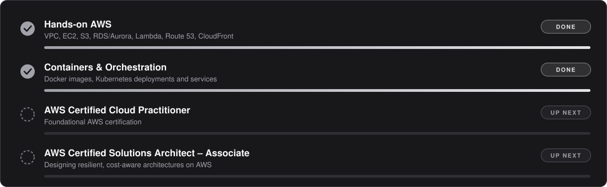

  

  
  
  

<h2 align="center">About Me</h2>

  

<h2 align="center">What I Do</h2>

  

<h2 align="center">Tech Stack</h2>

  <b>CLOUD &AMP; INFRASTRUCTURE</b> 
  &nbsp;
  &nbsp;
  

  <b>CONTAINERS &AMP; CI/CD</b> 
  &nbsp;
  &nbsp;
  &nbsp;
  

  <b>MONITORING &AMP; OBSERVABILITY</b> 
  &nbsp;
  

  <b>DATA &AMP; ANALYTICS</b> 
  &nbsp;
  &nbsp;
  

  <b>LANGUAGES &AMP; FRAMEWORKS</b> 
  &nbsp;
  &nbsp;
  &nbsp;
  &nbsp;
  &nbsp;
  

  <b>TOOLS</b> 
  &nbsp;
  &nbsp;
  

<h2 align="center">My Journey</h2>

  

<h2 align="center">Currently Working Toward</h2>

  

  

