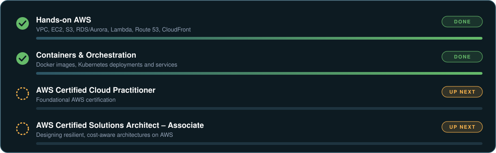



  

  
  
  

<h2 align="left" style="color: #6552b0; letter-spacing: 0.03em; margin-top: 18px;">👩‍💻 About Me</h2>

  

<h2 align="left" style="color: #6552b0; letter-spacing: 0.03em;">⚡ What I Do</h2>

  

<h2 align="left" style="color: #6552b0; letter-spacing: 0.03em;">🛠️ Tech Stack</h2>

<b style="color: #7d6bb8;">☁️ Cloud &amp; DevOps</b>

  

<b style="color: #7d6bb8;">💻 Languages &amp; Frameworks</b>

  

<b style="color: #7d6bb8;">🗄️ Databases &amp; Tools</b>

  

<h2 align="left" style="color: #6552b0; letter-spacing: 0.03em;">🧭 My Journey</h2>

  

<h2 align="left" style="color: #6552b0; letter-spacing: 0.03em;">🎯 Currently Working Toward</h2>

  

  

